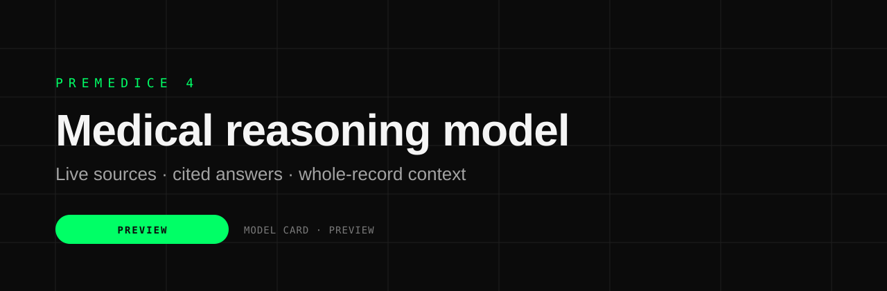
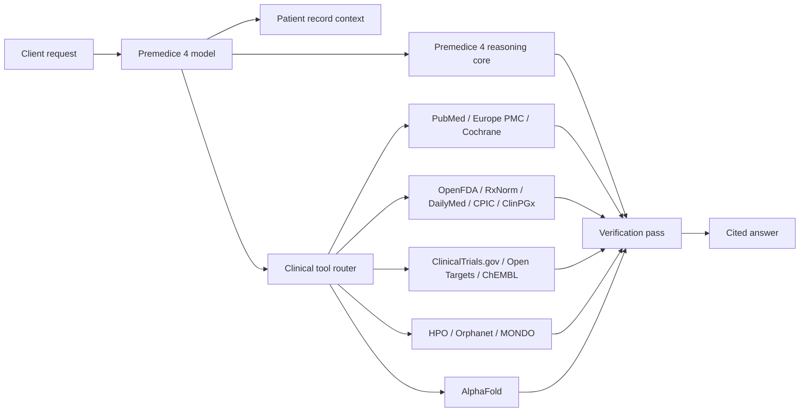

<div align="center">
  
</div>

<h1 align="center">Premedice 4</h1>

<p align="center">
  <strong>A medical reasoning model.</strong><br/>
  One model identifier. Live clinical sources. Cited answers. Whole-record context.
</p>

<p align="center">
  <a href="https://premedice.com">Premedice</a> ·
  <a href="https://api.premedice.com">API</a> ·
  <a href="https://premedice.com/doctors/">For clinicians</a> ·
  <a href="https://github.com/Pakakothaproject/premedice">App overview</a>
</p>

<p align="center">
  
  
  
  
</p>

---

## What Premedice 4 is

Premedice 4 is a **proprietary medical reasoning model** built and operated by Premedice.

It combines a reasoning core with a clinical tool router, whole-record context and a verification pass. It reads the request, plans the evidence work, retrieves from clinical sources, drafts the answer, checks it against the evidence, and returns one cited response.

**What the model adds:**

- whole-record context (labs, medicines, documents, history)
- live access to clinical sources
- tool routing for evidence retrieval
- citation and uncertainty checks
- a second-pass verification layer
- earlier warning tracking across the record
- one OpenAI-compatible model identifier

You send one request. Premedice 4 plans the evidence work, runs the tools, reads the results, and returns a single cited answer. Its main advantage is tracking warning signals earlier across labs, medicines, symptoms and history ? the changes a short visit can miss.

---

## Why Premedice 4?

Medical knowledge changes faster than any single model can be retrained. A model frozen at training time is a liability when labels change, trials read out, or a guideline is updated.

Premedice 4 treats the model as the **reasoning layer**, not the **knowledge layer**:

1. Read the request and the patient context.
2. Decide which clinical sources are required.
3. Retrieve from those sources in parallel where possible.
4. Draft the answer from the retrieved evidence.
5. Verify claims against the tool output.
6. Return one answer with citations and explicit uncertainty.

---

## Architecture



---

## Evaluation status

Premedice 4 is in preview. The composite model evaluation is in progress.

| Evaluation | Status |
|---|---|
| Medical reasoning | In progress |
| Citation precision | In progress |
| Tool-call accuracy | In progress |
| Safety / red-flag handling | In progress |
| External clinical validation | Not yet published |
| Public benchmark results | Not yet published |

We do not republish third-party benchmark results as Premedice 4 results. Composite results will be published with their methodology and limitations.

## What Premedice 4 is good at

- Medical question answering with retrieved evidence
- Lab and document interpretation
- Drug interaction and pharmacogenomic review
- Guideline and trial lookup
- Rare-disease phenotype matching
- Literature synthesis with citations
- Patient-education drafts
- Clinician-ready summaries

## What it is not for

- Diagnosis or treatment decisions
- Replacing a licensed clinician
- Real-time clinical monitoring
- DICOM, ECG or imaging interpretation
- Emergency care

---

## API

Premedice 4 is being prepared for release through the Premedice API and OpenRouter. The request shape below is the preview contract; the OpenRouter listing is not live yet.

```bash
curl https://api.premedice.com/v1/chat/completions \
  -H "Authorization: Bearer pm_live_YOUR_KEY" \
  -H "Content-Type: application/json" \
  -d '{
    "model": "premedice-4",
    "messages": [
      {"role": "user", "content": "Review these labs in the context of the patient's current medications and flag what should be discussed with a clinician."}
    ]
  }'
```

OpenAI-compatible request and streaming shape. Tool calls happen server-side. Final availability will be announced with the OpenRouter listing.

---

## Specifications

| Property | Value |
|---|---|
| Model ID | `premedice-4` |
| Class | Proprietary medical reasoning model |
| Input | Text + patient-record context |
| Output | Text + citations |
| Tool use | Server-side, automatic |
| Context | Large-context (preview) |
| Streaming | OpenAI-compatible SSE |
| Status | Preview |
| OpenRouter | Listing in preparation |

---

## Safety and limitations

- Premedice 4 is an information tool, not a medical device.
- Outputs may be incomplete, outdated or wrong.
- Citations should be read, not assumed.
- Clinical decisions require a licensed professional.
- Emergency symptoms require local emergency services.

---

## License

MIT for this model card and documentation. Model weights are not included. Premedice name and marks remain the property of Diagnostics AI, Inc.

See [LICENSE](LICENSE).
