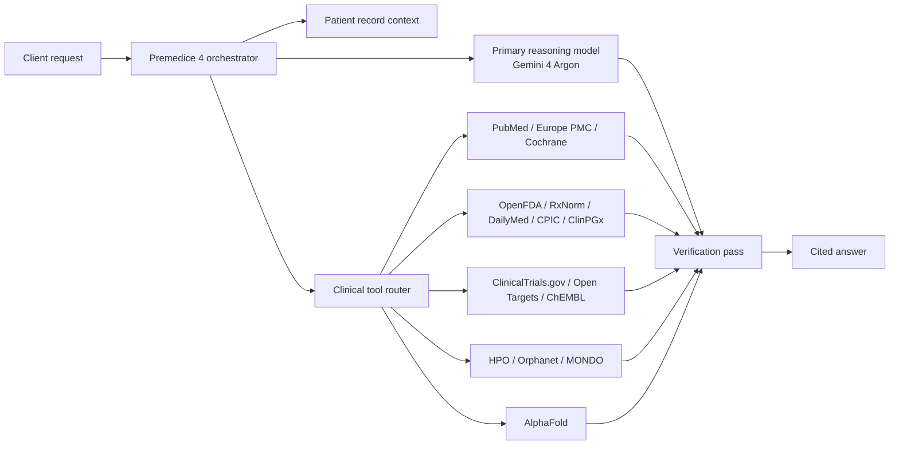

<div align="center">
  
</div>

<h1 align="center">Premedice 4</h1>

<p align="center">
  <strong>A medical reasoning orchestrator.</strong><br/>
  One model identifier. Live clinical sources. Cited answers. Whole-record context.
</p>

<p align="center">
  <a href="https://premedice.com">Premedice</a> ·
  <a href="https://api.premedice.com">API</a> ·
  <a href="https://premedice.com/doctors/">For clinicians</a> ·
  <a href="https://github.com/Pakakothaproject/premedice">App overview</a>
</p>

<p align="center">
  
  
  
  
</p>

---

## What Premedice 4 is

Premedice 4 is an **orchestrator model** for medical reasoning.

It is not a from-scratch foundation model. It is a composition layer that routes a request across frontier reasoning models and a clinical toolbelt, then verifies the answer against the sources it retrieved.

**Primary reasoning model:** Gemini 4 Argon.

**What the orchestrator adds:**

- whole-record context (labs, medicines, documents, history)
- live access to clinical sources
- tool routing for evidence retrieval
- citation and uncertainty checks
- a second-pass verification layer
- one OpenAI-compatible model identifier

You send one request. Premedice 4 plans the evidence work, runs the tools, reads the results, and returns a single cited answer.

---

## Why an orchestrator?

Medical knowledge changes faster than any single model can be retrained. A model frozen at training time is a liability when labels change, trials read out, or a guideline is updated.

Premedice 4 treats the model as the **reasoning layer**, not the **knowledge layer**:

1. Read the request and the patient context.
2. Decide which clinical sources are required.
3. Retrieve from those sources in parallel where possible.
4. Draft the answer from the retrieved evidence.
5. Verify claims against the tool output.
6. Return one answer with citations and explicit uncertainty.

---

## Architecture



---

## Upstream benchmark: Gemini 4 Argon

These are **Google DeepMind's published results for Gemini 4 Argon**, the primary reasoning model behind Premedice 4. They are **not** Premedice 4 composite results.

| Benchmark | Gemini 4 Argon |
|---|---:|
| AA Index v5.0 | 50 |
| Vals Index v2.2 | 69.2% |
| FrontierSWE 2 | 55.0% |
| Terminal-Bench 4.0 | 57.1% |
| Agents' Last Exam v1.1 | 69.0% |
| GraphWalks 256k–1M (F1) | 84.2% |
| RiemannBench | 76.0% |
| CWE-bench | 68.0% |
| SEC-bench Pro | 83.4% |

**Source:** Google DeepMind, Gemini 4 Argon performance table, October 2026 — [deepmind.google/models/gemini](https://deepmind.google/models/gemini/).

### Premedice 4 composite evaluation

| Evaluation | Status |
|---|---|
| Clinical reasoning | In progress |
| Citation precision | In progress |
| Tool-call accuracy | In progress |
| Safety / red-flag handling | In progress |
| External clinical validation | Not yet published |

We do not present upstream Argon benchmarks as Premedice 4 results. The composite evaluation will be published with its methodology and limitations.

---

## What Premedice 4 is good at

- Medical question answering with retrieved evidence
- Lab and document interpretation
- Drug interaction and pharmacogenomic review
- Guideline and trial lookup
- Rare-disease phenotype matching
- Literature synthesis with citations
- Patient-education drafts
- Clinician-ready summaries

## What it is not for

- Diagnosis or treatment decisions
- Replacing a licensed clinician
- Real-time clinical monitoring
- DICOM, ECG or imaging interpretation
- Emergency care

---

## API

Premedice 4 is being prepared for release through the Premedice API and OpenRouter. The request shape below is the preview contract; the OpenRouter listing is not live yet.

```bash
curl https://api.premedice.com/v1/chat/completions \
  -H "Authorization: Bearer pm_live_YOUR_KEY" \
  -H "Content-Type: application/json" \
  -d '{
    "model": "premedice-4",
    "messages": [
      {"role": "user", "content": "Review these labs in the context of the patient's current medications and flag what should be discussed with a clinician."}
    ]
  }'
```

OpenAI-compatible request and streaming shape. Tool calls happen server-side. Final availability will be announced with the OpenRouter listing.

---

## Specifications

| Property | Value |
|---|---|
| Model ID | `premedice-4` |
| Class | Medical reasoning orchestrator |
| Primary reasoning model | Gemini 4 Argon |
| Input | Text + patient-record context |
| Output | Text + citations |
| Tool use | Server-side, automatic |
| Context | 1M-token upstream context window |
| Streaming | OpenAI-compatible SSE |
| Status | Preview |
| OpenRouter | Listing in preparation |

---

## Safety and limitations

- Premedice 4 is an information tool, not a medical device.
- Outputs may be incomplete, outdated or wrong.
- Citations should be read, not assumed.
- Clinical decisions require a licensed professional.
- Emergency symptoms require local emergency services.

---

## License

MIT for this model card and documentation. Model weights are not included. Premedice name and marks remain the property of Diagnostics AI, Inc.

See [LICENSE](LICENSE).
