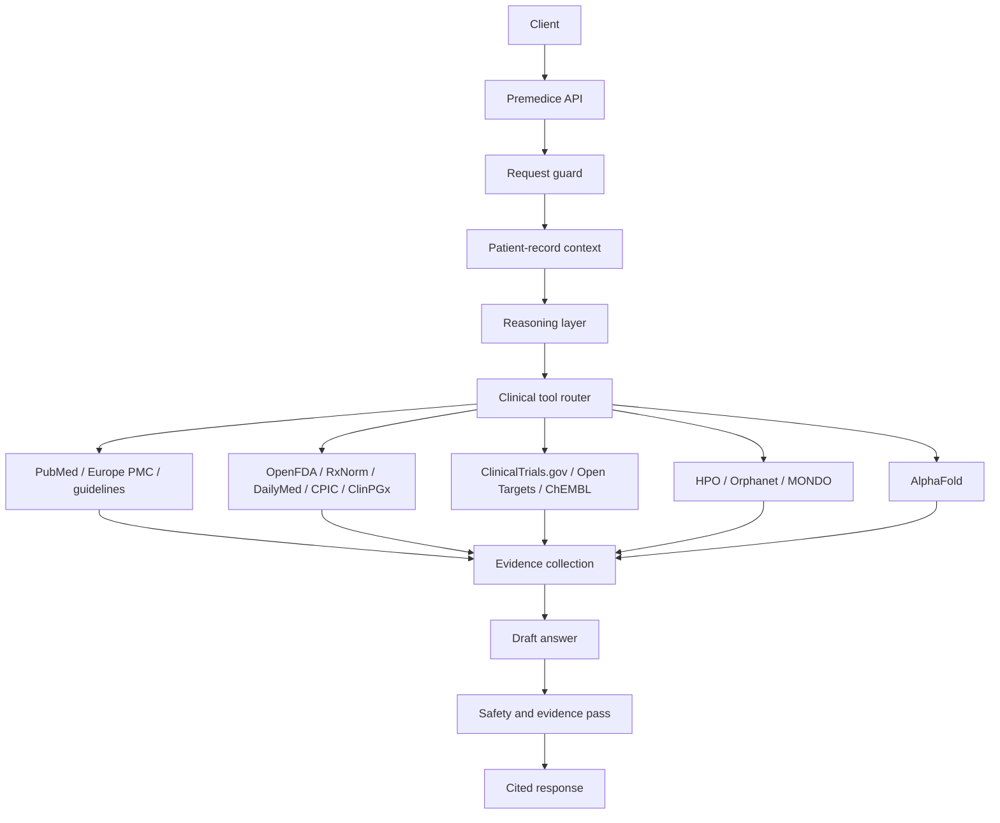

# Premedice 4 — Architecture

**Status:** Preview
**Last updated:** 3 November 2026

---

## Overview

Premedice 4 is an inference-time medical reasoning system. It is not a foundation model and does not ship model weights.

## Components

### Request guard

Validates input, applies rate limits, and checks for emergency or crisis language.

### Patient-record context

Adds the active care context: profile, conditions, medicines, allergies, labs, documents, timeline, and notes. The context must be scoped; one record must not leak into another.

### Reasoning layer

Plans the evidence work and drafts the answer. The model is a reasoning layer, not a static knowledge base.

### Clinical tool router

Selects and runs live sources. Tool results are treated as data, not instructions.

### Evidence collection

Normalizes sources, deduplicates them, and records source metadata.

### Safety and evidence pass

Checks the draft against retrieved sources and known red flags. This is a safety aid, not a guarantee.

### Response

Returns text, citations, and metadata where available.

## Design principles

1. Retrieval over memory.
2. Citations over confidence.
3. Explicit uncertainty over invented certainty.
4. Scoped context over global access.
5. Human review over autonomous action.
6. No PHI in logs.
7. No foundation-model claim.

## What this architecture does not provide

- diagnosis
- prescribing
- emergency triage
- real-time monitoring
- imaging interpretation
- a guarantee that every claim is correct
