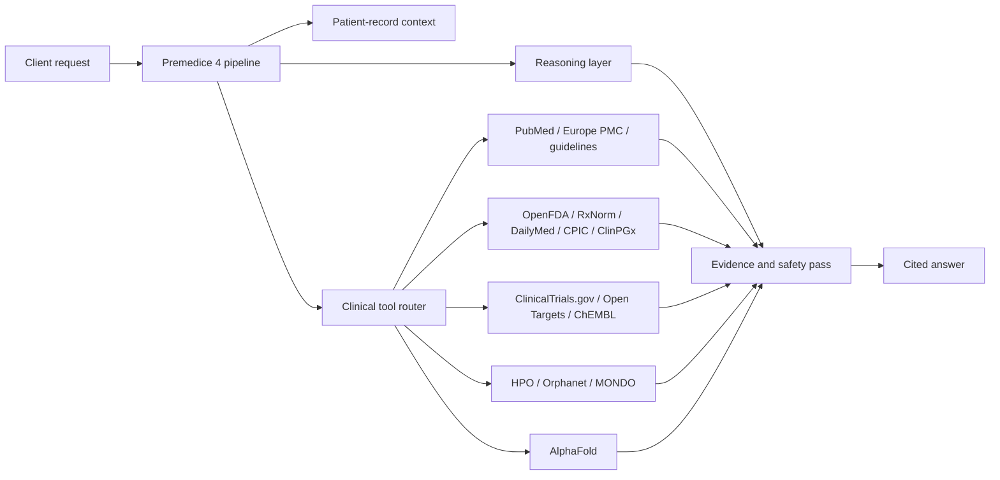

# Premedice 4 — Model Card

**Status:** Preview
**Last updated:** 3 November 2026
**Model ID:** `Premedice/Premed-4`
**Provider:** Premedice
**License:** MIT for this model card and documentation. Model weights are not distributed.

---

## 1. Summary

Premedice 4 is a proprietary medical reasoning system built and operated by Premedice.

It is an inference-time system that combines a reasoning layer, a clinical tool router, patient-record context, and a post-answer verification pass. It retrieves from live clinical sources, drafts an answer, checks the answer against retrieved evidence, and returns a cited response.

Premedice 4 is **not a foundation model**. It does not ship model weights, and this repository does not contain a training corpus. The product is proprietary; the upstream language models it routes to are not.

---

## 2. Intended use

Premedice 4 is intended for:

- medical question answering with retrieved evidence
- lab and document interpretation
- drug-interaction and pharmacogenomic review
- guideline and trial lookup
- rare-disease phenotype matching
- literature synthesis with citations
- patient-education drafts
- clinician-ready summaries

It is intended to support, not replace, a licensed clinician.

---

## 3. Out-of-scope use

Premedice 4 is **not** intended for:

- diagnosis or autonomous treatment decisions
- prescribing or dose authorization
- replacing a licensed clinician
- real-time clinical monitoring
- DICOM, ECG, or imaging interpretation
- emergency care or emergency triage
- insurance, employment, or legal decisions
- use without human review in a clinical workflow

Emergency symptoms require local emergency services. Premedice is an information tool, not a medical device.

---

## 4. Architecture

The pipeline is retrieval-first. The model is the reasoning layer; live sources are the knowledge layer.

---

## 5. Inputs and outputs

**Input:** text, optional patient-record context, and an OpenAI-compatible messages array.

**Output:** text with citations, uncertainty language, and source metadata where available.

**Tool use:** server-side and automatic. Callers do not need to orchestrate individual clinical tools.

---

## 6. Training and adaptation

Premedice 4 is an inference-time product system. This repository does not distribute model weights or a training dataset.

Product behavior comes from orchestration, prompts, retrieval, tool routing, and verification. Do not treat the public model card as a claim that Premedice trained a foundation model from scratch.

---

## 7. Data handling

- Do not submit protected health information unless you are using an authorized deployment with an appropriate agreement.
- Do not include PHI in public GitHub issues.
- See the Premedice privacy policy and the deployment's data-processing terms for retention and residency details.
- This repository does not contain patient data.

---

## 8. Evaluation status

Premedice 4 is in preview. No public clinical accuracy benchmark has been published.

| Evaluation | Status |
|---|---|
| Medical reasoning | Not yet published |
| Citation precision | Not yet published |
| Tool-call accuracy | Not yet published |
| Safety / red-flag handling | Not yet published |
| External clinical validation | Not yet published |
| Public benchmark results | Not yet published |

The evaluation protocol is in [evaluation.md](evaluation.md). Results will be published with the test set, adjudication method, failures, and limitations. Third-party benchmark results are not republished as Premedice 4 results.

---

## 9. Known limitations

- Outputs can be incomplete, outdated, or wrong.
- Retrieval can fail or return weak sources.
- The verifier is a safety aid, not a guarantee.
- Emergency and crisis detection are not complete.
- The system does not examine the patient.
- The system does not replace clinical judgment.
- Doctor identity verification and signed clinical review are still being expanded.
- Global reference ranges and localization are not complete.
- Latency is not yet covered by a public SLA.

See [limitations.md](limitations.md) and [safety.md](safety.md).

---

## 10. Ethical and legal notes

- Premedice 4 is decision support, not a diagnosis.
- Clinical decisions require a licensed professional.
- The system must not be used to deny care or coverage.
- Any clinical deployment requires local legal, regulatory, and clinical governance review.
- FDA CDS, EU AI Act, GDPR, and local medical-device rules may apply.

---

## 11. Citation

If you refer to this model card, cite:

> Premedice. *Premedice 4 — Model Card.* Preview, 3 November 2026. https://github.com/Pakakothaproject/premedice-4

A machine-readable citation is available in [CITATION.cff](../CITATION.cff).
